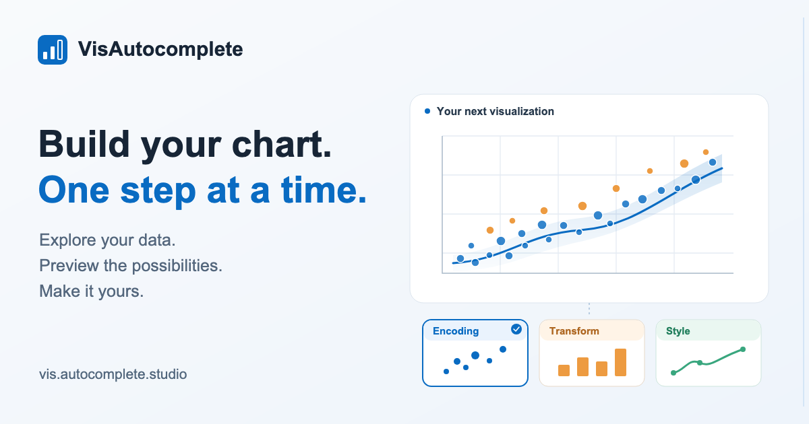

# VisAutocomplete

**Build your chart, one step at a time.**

VisAutocomplete is an interactive visualization editor that recommends what to do next. Start with your data, compare chart and action previews, adjust their parameters, and apply the changes you want. Each step produces editable [ggaction](https://github.com/ggaction/ggaction) code and a history you can revisit.

[Try the app](https://vis.autocomplete.studio/) · [Contribute](CONTRIBUTING.md) · [Developer guide](docs/development.md) · [Documentation](docs/README.md) · [Report a bug](https://github.com/ggaction/vis-autocomplete/issues/new/choose)

[](https://vis.autocomplete.studio/)

## Try it in a minute

1. Open [VisAutocomplete](https://vis.autocomplete.studio/) and choose **Try without account**, or sign in to save and manage projects.
2. Upload a CSV, JSON, or Excel `.xlsx` file, or choose an example dataset. Select the columns you want to explore; you do not need to assign X, Y, and Color first.
3. Hover an option card to preview its chart. Explore the card's parameters, then click **Apply** to keep the change.
4. Keep building: change encodings, add statistics, combine charts, edit text, or revisit a step in History.

Hovering explores; **Apply commits**. Direct edits also become undoable history steps. Guest drafts stay in the browser; signing in enables private cloud projects. See the [privacy notice](https://vis.autocomplete.studio/privacy.html) for optional research collection and data handling.

## What you can build

- **Explore beyond standard charts.** Recommendations cover scatter, bar, line, area, box, violin, beeswarm, heatmap, polar, radar, parallel coordinates, and other supported chart families.
- **Compare concrete next steps.** Encoding, Transform, and Style cards expose editable parameters. Search for a specific action when you know what you want.
- **Combine views.** Layer charts, add overlays that follow existing results, facet by a field, or place charts beside one another with compatible shared scales.
- **Edit directly.** Resize charts and guides, move titles and legends, edit categorical text in place, and undo or redo your changes.
- **Keep the authoring process.** Switch between Linear and Graph History, inspect generated ggaction code, and export PNG, SVG, or PDF.
- **Choose your preview.** Transition mode animates the current view to a candidate; Preview mode keeps current and candidate views separate.

Recommendations are ranked using patterns from a chart corpus and chart compatibility rules.

## Start developing

Use **Git and Node.js 22**; CI's exact version is recorded in [.nvmrc](.nvmrc). The app consumes two pinned source submodules, so clone recursively:

```sh
git clone --recurse-submodules https://github.com/ggaction/vis-autocomplete.git
cd vis-autocomplete
npm ci
npm run demo:quickstart
```

The quickstart prints recommended ggaction actions and writes two SVGs to `output/quickstart/`. It runs with the included dataset and model, without cloud configuration.

For an existing checkout, initialize the dependencies with `git submodule update --init --recursive`. A GitHub ZIP download does not include their source.

To run the browser UI, follow the [local editor setup](docs/development.md#run-the-editor) for Supabase configuration and browser testing.

Useful first checks:

```sh
npm run check:docs
npm run catalog:check
node --test test/model.test.js test/project.test.js
npm run build
```

Full regression, browser, corpus, and library checks are documented in the [developer guide](docs/development.md#choose-the-right-checks). Retraining the corpus is not part of ordinary setup.

## Contribute

Bug reports, documentation, accessibility testing, performance improvements, and code contributions are welcome.

Browse [issues](https://github.com/ggaction/vis-autocomplete/issues) and read [CONTRIBUTING.md](CONTRIBUTING.md) to get started.

| Where | What belongs there |
| --- | --- |
| This repository | Recommendations, option cards, editor interaction, history, accounts, and research logging |
| [ggaction](https://github.com/ggaction/ggaction) | Public chart actions, rendering, inspection, types, and chart semantics |
| [@ggaction/transition](https://github.com/ggaction/transition) | Interruptible Canvas/SVG scene playback |
| [chart-datasets](https://github.com/ggaction/chart-datasets) | Upstream chart corpus and source provenance |

See the [architecture guide](docs/architecture.md) for how these components fit together.

Please use [private security reporting](SECURITY.md) for vulnerabilities. Participation follows our [Code of Conduct](CODE_OF_CONDUCT.md).

## Research

This tool builds on:

- **[Visualization Autocomplete: Visualization Authoring via Stepwise Design Recommendations](https://arxiv.org/abs/2607.15608)** — Hyeon Jeon, Sungbok Shin, and Niklas Elmqvist. *Transactions on Visualization and Computer Graphics (TVCG, Proc. VIS 2026).* [Legacy version for the paper](https://oldvis.autocomplete.studio/).
- **[ggaction: A Grammar of Graphical Actions](https://arxiv.org/abs/2609.14353)** — Hyeon Jeon and Jinwook Seo. *arXiv.*

Citation information is available in [CITATION.cff](CITATION.cff).

## License

Original code and documentation are licensed under [Apache-2.0](LICENSE). Third-party code and datasets retain their own licenses; see [THIRD_PARTY_NOTICES.md](THIRD_PARTY_NOTICES.md) and the [licensing guide](docs/licensing.md).
