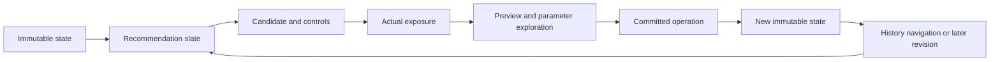

# Detailed research logging (protocol 2)

This implements the October 26 research-log request. Research transport is separate from private project autosave and dataset uploads. These changes are **not deployed** by an ordinary push; the database migration and release checklist below are required at the next user-authorized version release.

## Consent and content

There is **one research-sharing checkbox**. Existing explicit `history-only-v1` opt-ins continue; existing opt-outs remain off. An unknown choice still requires the initial dialog. This follows the subsequent product decision to carry existing consent forward and include field names, chart text, and original search terms. The in-app notice and privacy page describe this expanded scope. No second text/statistics checkbox is presented.

Collected:

- Recommendation generation, order, scores and available evidence; mounted controls and defaults; actual viewport exposures; preview request/preparation/transition outcomes.
- Parameter paths, available choices and bounds, conditional visibility, discrete exploration/selection, and sampled continuous trajectories.
- Original debounced search text, search IDs, prior slate, result slates, selected actions.
- Immutable structural state revisions, ggaction call deltas/checkpoints, logical operations and their actual prerequisite/action/post-action calls, target scope, history node IDs, undo/redo/jump, graph navigation, and input modality.
- Field names/types and row count; chart text from committed graphics and explicit title/annotation/label edits. Text is associated through random references, not hashes of sensitive strings.
- Self-declared AI use in Settings. An unchecked AI box means unknown, not verified human. The ingest server stamps guest status from Auth, never from user metadata.

Excluded:

- Dataset rows, uploaded files, raw CSV/JSON/workbook contents, passwords/tokens/email, raw error messages, and data filter thresholds/domains. Private cloud documents are never used as a research source.
- Distribution profiles/histograms or row-level research contributions. Event kind `statistics` is reserved and rejected by the database until a separate future contract exists.

Text is not anonymous. Researchers with access may see sensitive information a user wrote into a title or query. Access is limited to `app_admins`; ordinary authenticated users cannot enumerate the batches or identity mapping. `research_participants` maps account IDs to random research participant IDs and has no browser read grant. Server-side maintenance privileges remain privileged.

Withdrawal immediately stops collection, clears pending batches, broadcasts invalidation to other tabs, and changes the server consent epoch. An offline withdrawal/deletion is persisted locally and retried; reload does not silently resume collection. “Delete my research history” deletes v1/v2 research data and leaves a pseudonymous deletion tombstone for downstream export cleanup. It does not delete private projects. A session that has already sent data cannot recall an in-flight transaction committed before withdrawal; SQL serializes consent against ingestion.

## Causal model



A state ID is independent of a history node ID. Consecutive direct manipulation may replace the same visual history cell, while each research operation still has a separate state and operation identity. History navigation records the actual successful source/destination node after restoration, including graph UUID targets; it does not infer an index from an Undo/Redo label.

A new slate identifies an authoring state, target/group/search and recommendation mode (initial, normal, overlay or adjacent). Candidate generation is distinct from IntersectionObserver-confirmed exposure. Cached decks get new exposure/decision contexts. Streaming updates retain slot identities within a slate. Offscreen/computed candidates are unknown outcomes, never negative examples solely because they were not clicked.

Preview stages distinguish requested, ready, rendered/transition-started, settled, failed and superseded. “Rendered” means the native render/transition was submitted; it is not a browser compositor guarantee or evidence of attention. Hidden tabs and window blur end active exposure/exploration intervals. No gaze or attention is inferred from pointer position.

## Parameters, code and gestures

- Discrete hover and selection boundaries are retained, including keyboard choice changes. Slider pin/unpin is explicit.
- Continuous controls retain the first/final values, minima/maxima, reversal count, number of input updates, elapsed time and a 100 ms trajectory sample. Each trace is bounded to 256 samples; truncation is explicit. Dense trajectories are observations, not reconstructed 60 Hz playback.
- Direct drag traces include normalized coordinates, handles, selected element IDs, intended calls and actual committed calls. The authoritative code/state delta records automatic layout adjustments. Snap/layout effects can be analyzed from these calls; there is no pixel-perfect replay without the excluded underlying data.
- Shared immutable calls are compared by identity; the unchanged prefix is not repeatedly serialized. Every 20th new state is a structural checkpoint. Repeated manipulation retains distinct states while UI history coalesces.
- The collector has no dependency on recommendation computation or drawing. It does not alter ranking or activate randomized exploration. Logged scores are **not** selection propensities; policy remains deterministic and probability is null.

## Wire format and limits

`web/research/vocabulary.json` is the immutable protocol-2 public vocabulary. It contains public action names, option paths and enums, not user content. Do not reorder it. A future incompatible vocabulary requires a new codec version and decoder. Client, Node ingest and SQL bounds must agree.

Typed trees use tags: `0` finite numeric design/measurement, `1` public vocabulary index, `2` random reference, `3` list, `4` object entries, `5` omitted. User text is sent once in a separate reference dictionary. Numeric data values are not automatically classified as design values. Fields whose names happen to match public enum words remain field references.

Per-event limits: 12,000 encoded visits, nesting depth 20, 512 list/object entries, 2,048 characters per shared text, 24,000 aliases / 2 MiB alias-key memory per session. Committed graphic-text summaries contain at most 256 entries plus a total/truncation count. Large/unsupported values are explicitly omitted. These bounded summaries cannot promise complete reconstruction of arbitrarily large histories or label collections.

Delivery:

1. Synchronous input path creates only a bounded sanitized event; raw dataset objects never enter IndexedDB.
2. At 48 queued events or one second, a dedicated Worker serializes and gzip-compresses the batch. Batches also split at 240 KiB uncompressed; an oversized individual record is dropped with quality accounting rather than blocking the queue.
3. Each compressed batch is one IndexedDB transaction. The research queue is independent of private upload/thumbnail jobs and polls every five seconds. Hidden-page handling attempts an immediate flush; abrupt process termination can still lose the last in-memory interval.
4. Local queues are capped at 160 batches / 8 MiB and seven days. Overflow, storage errors, omissions and sequence gaps are recorded. Retry uses bounded exponential backoff and the same batch/event IDs. Unsupported worker/compression paths fail safely or use the asynchronous fallback; collection never waits on a renderer.
5. `/api/research` accepts bounded gzip, validates the wire structure, and forwards the user's bearer to Supabase. It never uses a service key. SQL checks authentication, consent epoch, event shape and text envelope again, ignores unrecognized outer payload keys, stamps guest status and performs idempotent insertion.

Timestamp semantics: each tab has its own session, monotonic event sequence and `performance.now()` time. Batch wall time and server receipt time support cross-tab analysis but are not a strict global clock. There is no distributed total-order claim. Duplicate IDs are deduplicated during extraction as well.

## Storage and analysis

`research_batches` stores compressed-by-Postgres JSONB envelopes instead of one SQL row/index entry per pointer sample. It is indexed by participant/session/sequence and participant/receipt time. Admin exports should include `participant_id`, `session_id`, `release`, `received_at`, `events`, `losses` and `first_sequence`, plus the current `research_deletions` table. Never include `research_participants.owner_id` in training exports.

```sh
node scripts/extract-research.js batches.json output/research-analysis \
  --deletions=deletions.json --cutoff=2027-01-01
```

The CLI writes decision slates, parameter trials, queries, operations, histories, reconstructed structural states and quality summaries. It preserves seen/explored/applied/default-accepted and observed Undo separately; future retention is censored rather than declared success. Participant-level splits prevent the same participant appearing in both training and validation. A separate temporal split supports time-based evaluation. AI/test actors and `test`/`development` releases are excluded from training eligibility. No deletion list produces an inspection-only warning. Rebuild downstream exports after applying deletion tombstones; trained models and external copies require a documented research-governance process.

Do not train until quality gates pass: supported protocol, known participant, deletion list applied, no unexplained sequence gaps, resolvable source state/slate, actual exposure for negative labels, and a declared actor policy. Missing previews, drop counts, omitted payloads and session endings are censoring signals, not dislikes. Default acceptance is weaker evidence than a deliberate parameter choice.

## Release checklist (not run in production in this change)

1. Apply `supabase/migrations/202610270001_research_v2.sql` before the frontend release. Keep Render automatic deployment off; only the user-authorized version tag may release.
2. Verify one opt-in, one opt-out, one guest, withdrawal, deletion, retry and cross-account isolation using dedicated fixtures. Do not use real users' private projects as research test inputs.
3. Verify `cron.job` contains `vis-research-retention`. The migration installs it when `pg_cron` is available. Otherwise configure an operator maintenance schedule before representing retention as automated. `prune_research_history()` removes detailed batches older than 90 days; historical v1 rows and analysis exports need their own cleanup.
4. Verify `/api/research` accepts gzip from the built client and that the Docker runtime includes `web/research` shared protocol files. Check batch error/drop metrics and queue age after release.
5. Export only pseudonymous batches and current deletion tombstones; monitor stale consent and storage errors. Review/synchronize the privacy notice whenever this schema's content scope changes.

## Verification evidence

Automated suites cover typed sanitization, exact/sample boundaries, state coalescing, unseen candidates, byte-based splitting, compression, offline retry, withdrawal during persistence, stale epochs, legacy opt-in continuity, guest isolation, database RLS, bounded ingest, extraction and participant splits. Browser fixtures use isolated fake Auth and transport, never production writes.

Validation on October 26: the isolated telemetry change passed all 838 application tests and the production-build account browser suite (Preview/Transition, facet/concat, direct manipulation and replay). After integrating the concurrently committed chart-filter changes, 53 affected integration tests and the production build passed. Guest and detailed-logging browser checks also passed. The final captured authoring fixture contained 291 events and 65 candidate records, with no duplicate events, sequence gaps, dropped events, invalid records or unresolved state/slate references. Intentional content exclusions are counted separately as omissions.

The benchmark `test/browser/research-performance.py` compares logging disabled/enabled during a 60 Hz loop using the actual gzip Worker and IndexedDB. On this machine, 721 events produced 16–17 writes (rather than 721) and approximately 136 KiB raw → 24 KiB compressed. Enqueue p95 was about 0.1 ms. Under 6× CPU throttling, p95 frame interval was about 18 ms with and without logging, with no frame above 50 ms in that run. This is a measured logging-overhead benchmark, not a guarantee for every dataset, browser, hardware configuration or chart-render workload. Run it again after changes to serialization or event volume.
